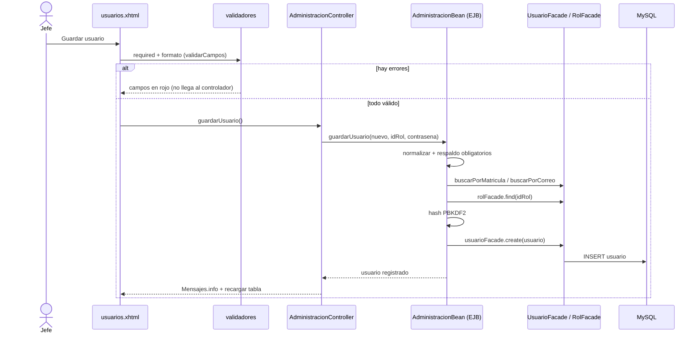
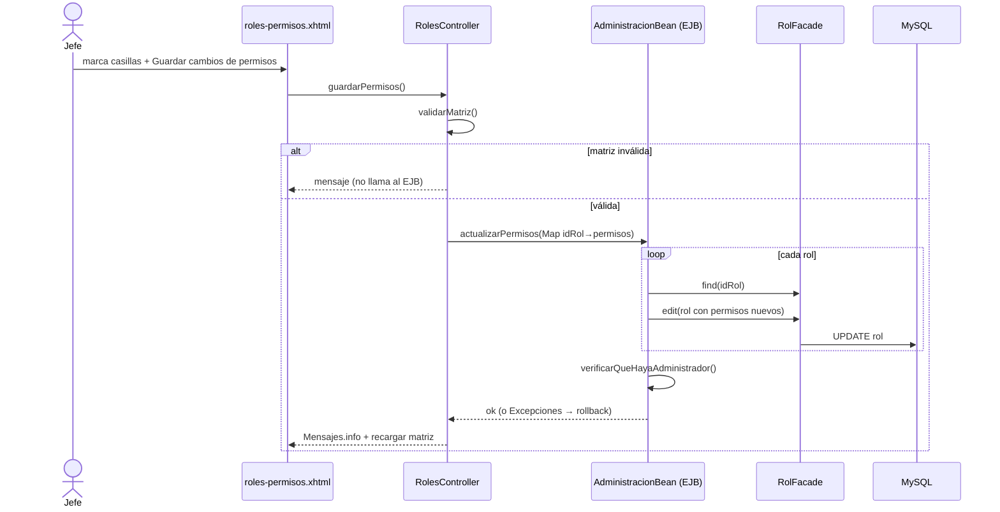
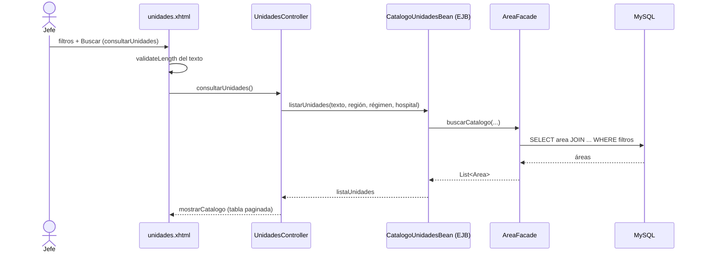
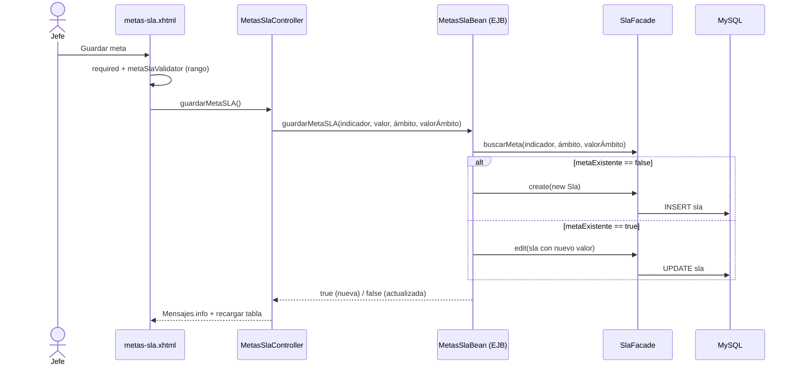
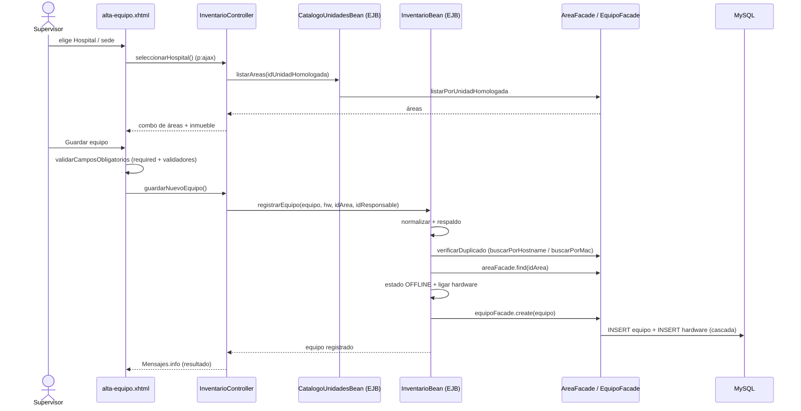

# RMM IMSS: cómo está construido y flujo de cada módulo

Este documento explica la arquitectura de la aplicación y el recorrido de cada
módulo implementado: desde que el usuario captura algo en la página hasta que
se guarda en la base de datos y regresa la respuesta.

Módulos cubiertos:

1. Usuarios (validaciones movidas a la vista)
2. Roles y permisos
3. Unidades (catálogo)
4. Metas SLA
5. Alta de equipo

---

## 1. Arquitectura general

La aplicación es un **EAR** con dos módulos:

| Módulo | Qué contiene | Paquetes |
|---|---|---|
| `imss.gob.mx.rmm-war` (web) | Lo que ve y usa el usuario | vistas `.xhtml`, `controlador`, `validadores` |
| `imss.gob.mx.rmm-ejb` (negocio) | Reglas de negocio y acceso a datos | `logica_negocio`, `acceso_datos`, `modelo`, `excepciones` |

Tecnologías: Jakarta EE 11 sobre GlassFish 8, Jakarta Faces (Mojarra) +
PrimeFaces 16, EJB, CDI, JPA (EclipseLink) y MySQL.

### 1.1 Capas y responsabilidades

```
┌──────────────────────────────────────────────────────────────────────┐
│ WAR                                                                  │
│                                                                      │
│  1. Vista (.xhtml)          Lo que ve el usuario. Formularios, tablas│
│        │                    required="true", <f:validator>, p:ajax   │
│        ▼                                                             │
│  2. Validadores (validadores.*)   Revisan formato y duplicados ANTES │
│        │                          de llegar al controlador.          │
│        ▼                                                             │
│  3. Controlador (controlador.*)   @Named @ViewScoped. Recibe los     │
│        │                          datos de la página, llama al EJB y │
│        │                          muestra el resultado (Mensajes).   │
└────────┼─────────────────────────────────────────────────────────────┘
         │  @EJB (llamada local)
┌────────┼─────────────────────────────────────────────────────────────┐
│ EJB    ▼                                                             │
│  4. Lógica de negocio (logica_negocio.*)  @Stateless. Reglas del     │
│        │                    negocio + validación de RESPALDO.        │
│        │                    Si algo falla lanza Excepciones.         │
│        ▼                                                             │
│  5. Acceso a datos (acceso_datos.*Facade)  Consultas JPQL y          │
│        │                    create / edit / find con EntityManager.  │
│        ▼                                                             │
│  6. Modelo (modelo.*)       Entidades JPA (una por tabla).           │
└────────┼─────────────────────────────────────────────────────────────┘
         ▼
      MySQL (persistence unit "rmmPU")
```

Regla de oro: **cada capa sólo habla con la de abajo**. La vista nunca toca
un Facade; el controlador nunca escribe JPQL; los Facades no tienen reglas
de negocio.

### 1.2 Equivalencia con los diagramas de secuencia (SD)

| Línea de vida en el SD | Clase en el código |
|---|---|
| `adminPage`, `equipoFormPage` (`<<web page>>`) | `vista/.../*.xhtml` + `validadores.*` |
| `adminCtrl`, `inventarioCtrl` (`<<control>>`) | `controlador.*Controller` (llamado desde la vista) y `logica_negocio.*Bean` (las reglas) |
| `usr`, `rol`, `sla`, `equipo`, `hw`, `unidad` | Entidades de `modelo.*` |
| `DBMS` | `acceso_datos.*Facade` → MySQL |

En los SD, `adminCtrl` aparece como una sola línea de vida. En el código se
reparte en dos piezas: el **controlador** del WAR, que atiende la pantalla, y
el **bean** del EJB, que aplica las reglas. Además, cada pantalla tiene su
propio controlador (`rolesCtrl`, `unidadesCtrl`, `metasSlaCtrl`), aunque en
los diagramas todos se llaman `adminCtrl`.

### 1.3 Mapa de archivos por módulo

| Módulo | Vista | Controlador (WAR) | Bean (EJB) | Facades | Entidades |
|---|---|---|---|---|---|
| Usuarios | `vista/administracion/usuarios.xhtml` | `AdministracionController` (`adminCtrl`) | `AdministracionBean` | `UsuarioFacade`, `RolFacade` | `Usuario`, `Rol` |
| Roles y permisos | `vista/administracion/roles-permisos.xhtml` | `RolesController` (`rolesCtrl`) | `AdministracionBean` + enum `Permiso` | `RolFacade` | `Rol` |
| Unidades | `vista/administracion/unidades.xhtml` | `UnidadesController` (`unidadesCtrl`) | `CatalogoUnidadesBean` | `AreaFacade`, `RegionFacade`, `UnidadHomologadaFacade` | `Area`, `UnidadHomologada`, `UnidadCc`, `CentroCosto`, `UnidadInformacion`, `Ubicacion`, `Region`, `Zona` |
| Metas SLA | `vista/administracion/metas-sla.xhtml` | `MetasSlaController` (`metasSlaCtrl`) | `MetasSlaBean` + enum `IndicadorSla` | `SlaFacade` | `Sla` |
| Alta de equipo | `vista/inventario/alta-equipo.xhtml` | `InventarioController` (`inventarioCtrl`) | `InventarioBean` (+ `CatalogoUnidadesBean`, `AdministracionBean`) | `EquipoFacade`, `AreaFacade`, `UsuarioFacade` | `Equipo`, `Hardware`, `Area` |

Piezas compartidas:

| Archivo | Para qué sirve |
|---|---|
| `excepciones/Excepciones.java` (EJB) | Error de negocio con el **campo** del formulario afectado |
| `logica_negocio/Validacion.java` (EJB) | `requerido(...)` y `limpiar(...)` para la validación de respaldo |
| `controlador/Mensajes.java` (WAR) | `info(...)` y `error(...)` para mostrar mensajes en la página |
| `validadores/ValidadorTexto.java` (WAR) | Base de los validadores de texto |
| `resources/css/comun/formularios.css` | Estilos de los formularios y tablas nuevos |
| `plantillas/partes/sidebar.xhtml` | Menú lateral con las rutas a cada vista |
| `WEB-INF/beans.xml` | Activa CDI en el WAR (necesario para los validadores con `@EJB`) |

---

## 2. Las validaciones: dónde vive cada una

Las validaciones de formato se pasaron del EJB a la vista. En el EJB sólo
quedó una **validación de respaldo**.

| Nivel | Dónde | Qué revisa | Cuándo se ejecuta |
|---|---|---|---|
| 1. Obligatorios | `required="true"` en el `.xhtml` | Que el campo no venga vacío | Al enviar el formulario |
| 2. Formato | `validadores.*Validator` | Matrícula, correo, contraseña, hostname, MAC, IP, rango de la meta | Al enviar el formulario |
| 3. Rangos simples | `<f:validateLength>`, `<f:validateLongRange>`, `<f:validateDoubleRange>` | Largo del texto, núcleos, RAM, disco | Al enviar el formulario |
| 4. Duplicados en vivo | `*DisponibleValidator` + `<p:ajax event="change">` | Matrícula, correo, hostname o MAC ya registrados | Al salir del campo |
| 5. Reglas de la pantalla | Controlador (sólo Roles y permisos) | Cada rol con al menos un permiso; algún rol con Administración | Al guardar |
| 6. **Respaldo** | Bean del EJB (`Validacion.requerido`, `verificar...`) | Obligatorios, duplicados, que existan rol/área/responsable | Al guardar, ya dentro de la transacción |

¿Por qué quedó un respaldo en el EJB? Dos personas pueden guardar al mismo
tiempo la misma matrícula o MAC. Además, otro cliente podría llamar al EJB sin
pasar por la página. El respaldo evita datos inválidos en ambos casos.

### 2.1 Validadores del WAR

| Validador (`validatorId`) | Regla | Usado en |
|---|---|---|
| `matriculaValidator` | 6 a 10 dígitos | Usuarios |
| `correoInstitucionalValidator` | `...@imss.gob.mx` | Usuarios |
| `contrasenaValidator` | 8 a 64 caracteres | Usuarios |
| `matriculaDisponibleValidator` | No registrada (llama a `AdministracionBean.verificarMatriculaDisponible`) | Usuarios |
| `correoDisponibleValidator` | No registrado (llama a `AdministracionBean.verificarCorreoDisponible`) | Usuarios |
| `hostnameValidator` | Letras, números y guiones (2 a 63), sin guion al inicio o final | Alta de equipo |
| `macValidator` | `AA:BB:CC:DD:EE:FF` (acepta `-`) | Alta de equipo |
| `ipValidator` | IPv4, cuatro números de 0 a 255 | Alta de equipo |
| `hostnameDisponibleValidator` | No registrado (llama a `InventarioBean.verificarHostnameDisponible`) | Alta de equipo |
| `macDisponibleValidator` | No registrada (llama a `InventarioBean.verificarMacDisponible`) | Alta de equipo |
| `metaSlaValidator` | Valor dentro del rango del indicador elegido (% de 0.01 a 100, horas de 0.01 a 720) | Metas SLA |

Detalles de construcción:

- `ValidadorTexto` es la clase base: ignora el campo vacío (eso lo revisa
  `required`), quita espacios y **convierte `Excepciones` en
  `ValidatorException`**. Así, el mismo método del EJB que usa el respaldo
  (`verificarMatriculaDisponible`, por ejemplo) también sirve para avisar en
  vivo en la página.
- Los validadores que consultan la base (`*DisponibleValidator`) llevan
  `@FacesValidator(value = "...", managed = true)` y `@Dependent`. Con
  `managed = true` Faces los crea mediante CDI, y `@Dependent` hace que CDI los
  registre (con `beans.xml` en modo `annotated`). Sin esas dos cosas no se
  puede inyectar el `@EJB`.
- `metaSlaValidator` necesita saber qué indicador se eligió. Lo lee del
  componente del indicador con
  `binding="#{indicadorComp}"` + `<f:attribute name="indicador" value="#{indicadorComp}"/>`,
  porque en ese momento el valor todavía no llega al controlador.

### 2.2 Cómo viaja un error

```
EJB:   throw new Excepciones("matricula", "La matrícula 99214812 ya está registrada");
         │   @ApplicationException(rollback = true):
         │   - llega tal cual al WAR (no se envuelve en EJBException)
         │   - deshace la transacción
         ▼
WAR:   catch (Excepciones e) → Mensajes.error("formUsuarios", e, "No se pudo registrar el usuario");
         │   - si e.getCampo() != null → mensaje en "formUsuarios:matricula" (campo en rojo)
         │   - mensaje general arriba del formulario
         │   - FacesContext.validationFailed()
         ▼
Vista: <p:message for="matricula"/> y <p:messages globalOnly="true"/>
```

Por eso el **campo** de cada `Excepciones` coincide con el `id` del componente
en el `.xhtml` (`matricula`, `correo`, `rol`, `hostname`, `mac`, `area`,
`indicador`, `region`, `unidad`...).

---

## 3. El ciclo de una petición en Faces (resumen)

Cada vez que se da clic en un botón (`p:commandButton`) o se dispara un
`p:ajax`, Faces recorre estas fases:

1. **Restore View**: recupera la vista y el controlador `@ViewScoped` (el mismo
   objeto mientras el usuario siga en esa página).
2. **Apply Request Values**: toma lo que escribió el usuario.
3. **Process Validations**: corre `required`, los `<f:validator>` y los
   `<f:validate...>`. **Si alguno falla, salta directo a la fase 6** (no se
   toca el controlador ni la base).
4. **Update Model Values**: copia los valores al controlador (`#{adminCtrl.nuevo.matricula}`...).
5. **Invoke Application**: ejecuta la acción (`action="#{adminCtrl.guardarUsuario}"`).
6. **Render Response**: vuelve a dibujar sólo lo indicado en `update="..."`.

El atributo `process="..."` decide qué componentes pasan por las fases 2 a 4
(por ejemplo `process="@this"` en un `p:ajax` valida sólo ese campo).

---

## 4. Flujo de cada módulo

### 4.1 Usuarios (SD-07a, rama `usuarioNuevo == true`)

**Ruta:** Administración → Usuarios (`/vista/administracion/usuarios.xhtml`)

**Al abrir la página**

1. Faces crea `AdministracionController` (`adminCtrl`) y ejecuta `init()` (`@PostConstruct`).
2. `init()` llama a `AdministracionBean.listarRoles()` y `listarUsuarios()`.
3. Éstos usan `RolFacade.findAll()` y `UsuarioFacade.findAll()`.
4. La página llena el combo de roles y la tabla de usuarios registrados.

**Mientras captura (validación en vivo)**

1. El usuario escribe la matrícula y sale del campo.
2. `<p:ajax event="change" process="@this">` envía sólo ese campo.
3. Corren `matriculaValidator` (formato) y `matriculaDisponibleValidator`.
4. `matriculaDisponibleValidator` → `AdministracionBean.verificarMatriculaDisponible()` → `UsuarioFacade.buscarPorMatricula()`.
5. Si existe, el EJB lanza `Excepciones`, `ValidadorTexto` la convierte en `ValidatorException` y el campo se marca en rojo.
6. Lo mismo pasa con el correo (`correoInstitucionalValidator` + `correoDisponibleValidator`).

**Al dar clic en "Guardar usuario"** (`guardarUsuario(datos, idRol)`)

1. **Vista**: `validarCampos()` del SD = `required` + validadores de todos los campos. Si algo falla, se detiene aquí.
2. **Controlador**: `adminCtrl.guardarUsuario()` → `administracionBean.guardarUsuario(nuevo, idRol, contrasena)`.
3. **Bean (EJB)**:
   1. `normalizar()`: quita espacios y pone el correo en minúsculas.
   2. Respaldo: `Validacion.requerido(...)` en matrícula, nombre, correo, rol y contraseña.
   3. `verificarMatriculaDisponible()` y `verificarCorreoDisponible()` (respaldo de duplicados).
   4. `asignarRol(rol)`: `rolFacade.find(idRol)`. Si no existe → `Excepciones("rol", ...)`.
   5. `crear(...)`: genera el hash PBKDF2 de la contraseña (`Pbkdf2PasswordHash`) y borra la contraseña de memoria.
   6. `estaActivo = true` → `usuarioFacade.create(usuario)` (`INSERT`).
4. **Controlador**: `mostrarConfirmacion()` → `Mensajes.info("Usuario registrado", ...)`, recarga la tabla y limpia el formulario.
5. **Si el EJB lanzó `Excepciones`**: `Mensajes.error("formUsuarios", e, ...)` marca el campo y muestra el error.



---

### 4.2 Roles y permisos (SD-07a, opt "el jefe edita permisos de un rol")

**Ruta:** Administración → Roles y permisos (`/vista/administracion/roles-permisos.xhtml`)

**Cómo se guardan los permisos:** la columna `rol.permisos` guarda códigos
separados por comas, por ejemplo
`VER_TABLEROS,VER_MONITOREO,GESTIONAR_ALERTAS,...,ADMINISTRAR`.
Los códigos válidos, su módulo y su descripción están en el enum
`logica_negocio.Permiso`.

**Al abrir la página**

1. `RolesController.init()` → `cargar()`.
2. `AdministracionBean.listarRoles()` → `RolFacade.findAll()` (ordenados por id: Jefe, Supervisor, Auxiliar).
3. Con `AdministracionBean.permisosDe(rol)` separa la cadena por comas y arma la **matriz**
   `Map<idRol, Map<códigoPermiso, Boolean>>`.
4. La vista dibuja una tabla: filas = `Permiso.values()`, columnas = roles, y cada celda es un
   `p:selectBooleanCheckbox` ligado a `#{rolesCtrl.matriz[r.idRol][p.codigo]}`.

**Al dar clic en "Guardar cambios de permisos"** (`editarPermisosRol(idRol, permisos)`)

1. **Vista**: envía todas las casillas (`process="panelMatriz"`) y Faces las copia a la matriz del controlador.
2. **Controlador** `guardarPermisos()`:
   1. `validarMatriz()` (validación de la vista): cada rol con al menos un permiso y algún rol con `ADMINISTRAR`. Si falla, muestra el mensaje y **no llama al EJB**.
   2. `permisosMarcados()` convierte la matriz en `Map<idRol, List<código>>`.
   3. Llama a `administracionBean.actualizarPermisos(mapa)`.
3. **Bean (EJB)** `actualizarPermisos(Map)`:
   1. Por cada rol llama a `aplicarPermisos(idRol, permisos)`, que es `actualizarPermisos(permisos)` del SD:
      - `rolFacade.find(idRol)`: si no existe → `Excepciones`.
      - Revisa que cada código exista en `Permiso` y que haya al menos uno.
      - Arma la cadena en el orden del enum → `rol.setPermisos(...)` → `rolFacade.edit(rol)` (`actualizarPermisosRol` → `UPDATE`).
   2. Al final, `verificarQueHayaAdministrador()`. Se revisa **una sola vez al final** para poder pasar Administración de un rol a otro en el mismo guardado.
   3. Si algo falla lanza `Excepciones` y, por `rollback = true`, **se deshacen todos los cambios** de esa llamada.
4. **Controlador**: `Mensajes.info("Permisos actualizados", ...)` y recarga la matriz desde la base.

"Descartar cambios" sólo vuelve a ejecutar `cargar()`.



---

### 4.3 Unidades (SD-07b Consultar catálogo de unidades)

**Ruta:** Administración → Unidades (`/vista/administracion/unidades.xhtml`)

Es un módulo **sólo de consulta**: no guarda nada, así que no tiene
validación de respaldo en el EJB.

**Qué es cada fila:** un **área** (unidad / servicio). Se muestra con su
hospital o sede (`unidad_homologada`), su centro de costo, división y
subdivisión, su inmueble (`ubicacion`), la clave UI, la región y el régimen.

```
area ──► unidad_homologada  (Hospital / sede) ──► region  ó  zona ──► region
  │
  ├──► unidad_cc ──► centro_costo        (Unidad / servicio)
  │         └────► unidad_informacion    (Clave UI, régimen)
  └──► ubicacion                         (Inmueble)
```

**Al abrir la página**

1. `UnidadesController.init()` carga `listarRegiones()` y `listarUnidadesHomologadas()` para los filtros.
2. Llama a `consultarUnidades()` sin filtros, que muestra todo el catálogo (1,166 áreas, paginadas de 15 en 15).

**Al dar clic en "Buscar"** (`consultarUnidades(filtro)`)

1. **Vista**: valida el texto con `<f:validateLength minimum="2" maximum="100">` (si se escribió algo).
2. **Controlador** `consultarUnidades()` → `catalogoBean.listarUnidades(texto, idRegion, regimen, idUnidadHomologada)`. Es `listarUnidades(filtro)` del SD.
3. **Bean (EJB)**: limpia el texto y llama a `AreaFacade.buscarCatalogo(...)`. Es `recuperarUnidades(filtro)` del SD.
4. **Facade**: arma la JPQL **sólo con los filtros que llegaron**:
   - texto → busca en clave/nombre de la unidad de información, centro de costo, unidad homologada e inmueble (`LIKE`, sin distinguir mayúsculas);
   - región → de la unidad homologada, o de la región de su zona;
   - régimen → `ORDINARIO` / `EX BIENESTAR`;
   - hospital / sede → `id_unidad_homologada`.
   El resultado se ordena por hospital, centro de costo, división y subdivisión.
5. **Vista**: `mostrarCatalogo(listaUnidades)` = el `p:dataTable` se vuelve a dibujar.

"Limpiar" borra los filtros y vuelve a consultar todo.



---

### 4.4 Metas SLA (SD-07c)

**Ruta:** Administración → Metas SLA (`/vista/administracion/metas-sla.xhtml`)

**Indicadores:** están en el enum `logica_negocio.IndicadorSla`. Cada uno
trae su nombre (se guarda en `sla.nombre_indicador`), su unidad de medida
(`sla.unidad_medida`) y el rango permitido.

| Indicador | Unidad | Rango |
|---|---|---|
| Disponibilidad de equipos | % | 0.01 a 100 |
| Incidencias resueltas dentro del SLA | % | 0.01 a 100 |
| Tiempo de primera atención | horas | 0.01 a 720 |
| Tiempo de resolución de incidencias | horas | 0.01 a 720 |

**Ámbito** (`sla.ambito` / `sla.valor_ambito`):

| Ámbito | `ambito` | `valor_ambito` |
|---|---|---|
| Global (todo el OOAD) | `GLOBAL` | `NULL` |
| Por región | `REGION` | `id_region` |
| Por hospital / sede | `UNIDAD` | `id_unidad_homologada` |

> El SD-07c menciona `periodo`, pero la tabla `sla` no tiene esa columna; en
> su lugar se usan ámbito y valor del ámbito.

**Al abrir la página**

1. `MetasSlaController.init()` carga regiones, hospitales/sedes (`listarUnidadesHomologadas()`) y las metas registradas (`MetasSlaBean.listarMetas()` → `SlaFacade.findAll()`).
2. Arma dos mapas (`id → nombre`) para mostrar en la tabla el nombre de la región o del hospital en lugar del id.

**Mientras captura**

- Al cambiar el **indicador**, un `p:ajax` actualiza la unidad que aparece junto al valor (% u horas).
- Al cambiar el **ámbito**, un `p:ajax` muestra el combo de región o de hospital/sede (`rendered="#{metasSlaCtrl.ambitoRegion}"`, etc.).

**Al dar clic en "Guardar meta"** (`guardarMetaSLA(indicador, valorMeta, ...)`)

1. **Vista**: `required` en indicador, meta y ámbito (y en región u hospital según el ámbito) + `metaSlaValidator` para el rango.
2. **Controlador** `guardarMetaSLA()`: calcula `valorAmbito` (id de región, id de unidad homologada o `null`) → `metasSlaBean.guardarMetaSLA(indicador, valorMeta, ambito, valorAmbito)`.
3. **Bean (EJB)**:
   1. Respaldo: indicador existente, meta y ámbito obligatorios, y valor del ámbito si no es global.
   2. `SlaFacade.buscarMeta(nombreIndicador, ambito, valorAmbito)` → `metaExistente`.
   3. **alt `metaExistente == false`**: `crear(...)` → `new Sla(...)` → `slaFacade.create()` (`insertarMetaSLA` → `INSERT`). Regresa `true`.
   4. **alt `metaExistente == true`**: `actualizarMeta(valorMeta)` → `slaFacade.edit()` (`actualizarMetaSLA` → `UPDATE`). Regresa `false`.
4. **Controlador**: `mostrarConfirmacion()` → "Meta registrada" o "Meta actualizada", recarga la tabla y limpia el formulario.

El botón **Editar** de la tabla sólo pasa los datos de esa meta al
formulario (`editar(s)`). Al guardar, como ya existe, cae en la rama
`metaExistente == true`.



---

### 4.5 Alta de equipo (SD-05c, `operacion == "alta"`)

**Ruta:** Inventario → Alta de equipo (`/vista/inventario/alta-equipo.xhtml`)

Las secciones del formulario siguen la pantalla PR-14: *Identificación en
red*, *Ubicación y área* y *Responsable y especificaciones*.

**Al abrir la página**

1. `InventarioController.init()` carga:
   - hospitales / sedes: `CatalogoUnidadesBean.listarUnidadesHomologadas()` (tabla `unidad_homologada`);
   - responsables: `AdministracionBean.listarUsuariosActivos()`.
2. Crea un `Equipo` y un `Hardware` vacíos para el formulario.

**Al elegir hospital / sede** (`seleccionarHospital(idUnidadHomologada)`)

1. `<p:ajax event="change" listener="#{inventarioCtrl.seleccionarHospital}">`.
2. **Controlador** → `catalogoBean.listarAreas(idUnidadHomologada)` (`listarAreas` del SD).
3. **Facade** `AreaFacade.listarPorUnidadHomologada()` → áreas de ese hospital.
4. Se actualiza el combo "Unidad / servicio (área)"; se habilita y se limpia la selección anterior.
5. Al elegir el área, otro `p:ajax` actualiza **Inmueble (automático)** con `getInmueble()` (`area.codigoUbicacion`).

**Mientras captura**: el hostname y la MAC se revisan al salir del campo
(formato + `hostnameDisponibleValidator` / `macDisponibleValidator`). Es el
"Aviso de MAC duplicada" de PR-14.

**Al dar clic en "Guardar equipo"** (`guardarNuevoEquipo(datos, idArea)`)

1. **Vista**: `validarCamposObligatorios()` del SD:
   - `required`: hostname, MAC, hospital y área;
   - formato: `hostnameValidator`, `macValidator`, `ipValidator`;
   - rangos: núcleos de 1 a 256, RAM de 1 a 1024 GB, disco de 16 a 100,000 GB.
2. **Controlador** `guardarNuevoEquipo()` → `inventarioBean.registrarEquipo(nuevo, hardware, idArea, idResponsable)` (`registrarEquipo` del SD).
3. **Bean (EJB)**:
   1. `normalizar()`: hostname en mayúsculas; MAC en mayúsculas y con `:`; quita espacios.
   2. Respaldo: hostname, MAC y área obligatorios.
   3. `verificarDuplicado(hostname, direccionMac)`.
   4. `areaFacade.find(idArea)`: debe existir y pertenecer a una unidad homologada.
   5. Si hay responsable, `usuarioFacade.find(idResponsable)`: debe existir.
   6. `crear(...)`: `fechaRegistro = ahora`, `estaActivo = true` y `actualizarEstado("OFFLINE")` (todavía no reporta un agente).
   7. `hw.crear(...)`: si se capturó algún dato de hardware, se liga al equipo (`hardware.setIdEquipo(equipo)` y `equipo.setHardware(hardware)`).
   8. `equipoFacade.create(equipo)`: `INSERT` en `equipo` y, **en cascada**, en `hardware` (`insertarEquipo` + `insertarHardware`).
4. **Controlador**: `mostrarResultado(resultado)` → "Equipo registrado ... quedó en estado OFFLINE", y limpia el formulario.



---

## 5. Notas de configuración

| Situación | Solución aplicada |
|---|---|
| Error `@FacesValidator(...) could not be resolved by CDI` | Se agregó `WEB-INF/beans.xml` al WAR y `@Dependent` a los 4 `*DisponibleValidator` |
| Aviso amarillo "needs to have a Form in its ancestry" | Los `p:menuitem` de PrimeFaces son comandos: el `p:panelMenu` del menú lateral se envolvió en `<h:form id="formMenu">` (con `.menu-form { flex: 1; }` en `principal.css`) |
| Mensajes de componentes mezclados con los generales | Todos los `p:messages` de las vistas usan `globalOnly="true"`; los errores de cada campo van en su `p:message for="..."` |
| Cambios en clases Java o en `beans.xml` | Hacer **Clean & Build** y volver a desplegar; los cambios en `.xhtml` y `.css` sólo requieren guardar y recargar |

## 6. Agregado en C4

| Módulo | Diagramas | Archivos |
|---|---|---|
| Inicio de sesión real (matrícula o correo, PBKDF2, bloqueo de 15 min al 3er intento fallido, menú según permisos) | SD-00a, SN-00a, PR-01 | `AuthController`, `AutenticacionBean`, `UsuarioSesion`, `ResultadoLogin`, `login.xhtml`, `sidebar.xhtml` |
| Cerrar sesión (invalida la sesión) | SD-00b | `pie.xhtml` → `authCtrl.cerrarSesion()` |
| Acceso denegado y sesión expirada (30 min) | PR-19 | `filtro.FiltroAcceso`, `acceso-denegado.xhtml`, `sesion-expirada.xhtml`, `web.xml` |
| Editar usuario (datos, rol, estado, contraseña opcional) | SD-07a rama `usuarioNuevo == false` | `usuarios.xhtml` (botón Editar), `AdministracionBean.editarUsuario` |
| Lista de equipos | PR-12 (básica), SN-05c | `equipos.xhtml`, `EquiposController` |
| Editar y dar de baja equipo (INACTIVO con motivo y fecha) | SD-05c ramas edición y baja, PR-14 | `alta-equipo.xhtml?id=N`, `InventarioBean.editarEquipo/darDeBaja` |

Base de datos: `sql/migracion_c4.sql` (columnas `intentos_fallidos`, `bloqueado_hasta`, `fecha_baja`, `motivo_baja` y el usuario administrador 999999999 / admin; si ya existe, sólo lo actualiza). Para sólo crear o arreglar el administrador: `sql/admin_999999999.sql`.

## 7. Pendientes

- Administración → **Correo y conectores** (SD-07d).
- Inventario: ficha completa del equipo (PR-13) y KPI del inventario (PR-12 completo).
- Las 36 áreas sin `id_unidad_homologada` no aparecen en el alta de equipo.
- Los cambios de permisos de un rol se aplican la próxima vez que el usuario inicia sesión.
